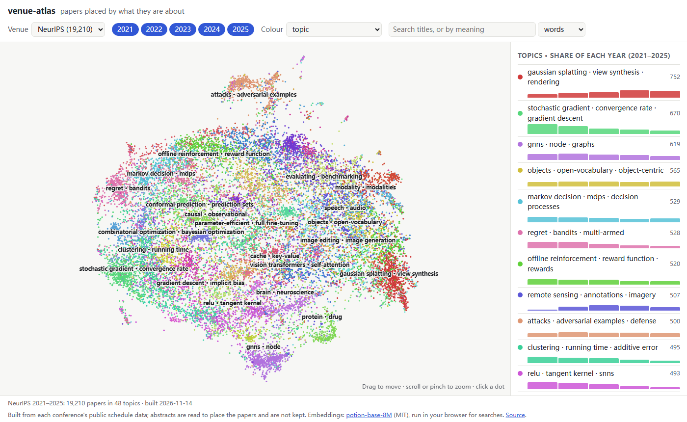

<div align="center">

# venue-atlas

**What a conference was about, year by year.** Every paper accepted at ICLR, NeurIPS, ICML, CVPR, ACL, EMNLP and
NAACL, placed on a map by what it is about, grouped into named topics with each topic's share of every year, and searchable by words or
by meaning, in your browser.

<a href="https://github.com/zch6a/venue-atlas/actions/workflows/ci.yml"></a>


<a href="LICENSE"></a>

**English** · [简体中文](README.zh-CN.md)

</div>

---

<p align="center"><a href="https://zch6a.github.io/venue-atlas/"></a></p>
<p align="center"><b><a href="https://zch6a.github.io/venue-atlas/">zch6a.github.io/venue-atlas</a></b></p>

| Venue | Years | Papers |
|---|---|---|
| ICLR | 2021–2025 | 9,662 |
| NeurIPS | 2021–2025 | 19,214 |
| ICML | 2021–2025 | 10,254 |
| CVPR | 2023–2025 | 7,946 |
| ACL | 2021–2025 | 5,122 |
| EMNLP | 2021–2025 | 5,798 |
| NAACL | 2021, 2022, 2024, 2025 | 2,199 |

The ACL venues are their main conferences (long and short papers; not Findings or workshops); NAACL had no 2023
(EACL's year).

Pick a venue and the years, hover over a dot for its title, click it for its links and the eight papers closest to
it in meaning. Each topic is named by the words that set its papers apart, with a bar for its share of every year:
at NeurIPS (as built on 2026-11-14), the chain-of-thought topic went from 18 papers in 2021 to 231 in 2025, and the
one on multimodal LLMs and vision-language models from 11 to 200. Search titles by words, or switch to *meaning*: the query is embedded in your browser with the
same model the map was built with, and the closest papers light up (the first such search downloads the model, 7 MB, once, and the venue's paper vectors, 4.7 MB for NeurIPS; the map itself is 1.5 MB).
Click a topic for its papers per year (a chart, with the numbers as text) and the list of its papers. The map takes
the keyboard too (arrow keys move it, + and − zoom, 0 resets, Escape clears); the topics, their papers and the
search results are lists of links, readable without the map.

## How it is made

- **The papers**: each conference's own virtual-site schedule file (`/static/virtual/data/<venue>-<year>-orals-posters.json`),
  one download per venue and year: titles, abstracts, the decision and the conference's topic. An oral listed as its
  talk and its poster is one paper; sessions and talks are left out. **Abstracts are read to place the papers and
  are not kept**: the site holds titles, links, years, decisions, topics and the map. ACL, EMNLP and NAACL come from
  the [ACL Anthology](https://aclanthology.org)'s BibTeX with abstracts (one 45 MB download for all of them, CC BY
  4.0), their long and short papers told apart by volume.
- **Meaning**: [potion-base-8M](https://huggingface.co/minishlab/potion-base-8M) (MIT), a static
  [Model2Vec](https://github.com/MinishLab/model2vec) embedding model run with numpy, pinned by revision and SHA-256;
  each paper is its title and abstract, the venue's mean taken away so that neighbours are found by what sets papers
  apart.
- **The map**: the 20 nearest neighbours of each paper, laid out in the plane the way UMAP does (a fuzzy neighbour
  graph, then attraction along its edges and repulsion between random pairs), in a small deterministic numpy form.
- **Topics**: k-means on the embeddings (about √n / 2 topics, at most 48), topics of a handful of papers folded into
  the nearest, each named by class-based TF-IDF over titles and abstracts (LaTeX maths left out).
- **Search in the browser**: the model's token vectors (int8) and the papers' vectors (int8) are part of the site;
  the browser's WordPiece tokenizer is tested against the Python tokenizer's output, and its top results match
  `venue-atlas search`.

The site is rebuilt each month by a GitHub workflow: the build runs with a read-only token, the deploy step runs
nothing of the project.

## Build it yourself

```bash
uvx --from git+https://github.com/zch6a/venue-atlas venue-atlas model                  # the model, 30 MB, once
uvx --from git+https://github.com/zch6a/venue-atlas venue-atlas build iclr icml --out site
python -m http.server --directory site                                                  # then open http://localhost:8000
uvx --from git+https://github.com/zch6a/venue-atlas venue-atlas search "diffusion for proteins" --venue icml --atlas site
```

`--years 2024,2025` builds some years only; `venue-atlas venues` lists what it knows. Downloads are kept in
`.cache/venue-atlas`, so a second build fetches nothing. `search --json` gives the closest papers as JSON (for an
agent or a script).

## Limits

- A static embedding model is small and fast, and coarser than a transformer: it places a paper by its words, so
  two papers that say the same thing in other words can land apart. Topic names are the topic's distinctive words,
  not a summary written by anyone.
- The map keeps neighbours together and spreads topics out, but the distances between far-apart regions mean little.
- It covers the venues whose sites publish this file (CVPR from 2023), and the Anthology's main conferences. A conference that changes its site's format
  needs a new reader; the build says which file it could not read.
- Papers are as the schedule lists them: workshop papers are not in it; titles are the conference's.

## Also in this toolkit

[paper-impact](https://github.com/zch6a/paper-impact) shows the citations of each venue's papers, normalized ·
[scholar-cards](https://github.com/zch6a/scholar-cards) makes citation cards for researchers' pages ·
[repro-score](https://github.com/zch6a/repro-score) scores a paper's code for reproducibility.

## License

MIT. The embedding model is potion-base-8M by MinishLab, MIT licensed. Titles and links are the conferences'.
