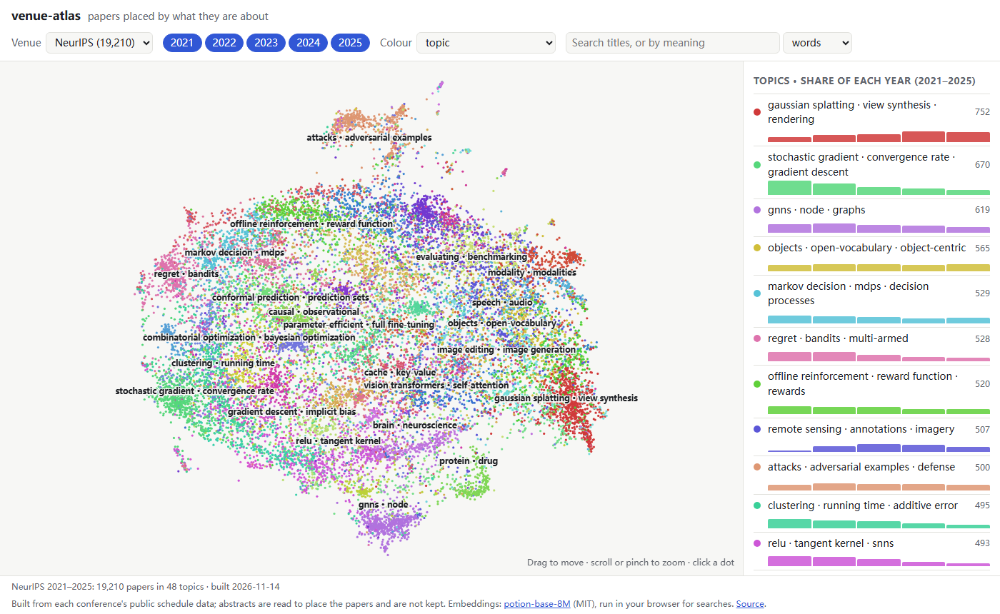

<div align="center">

# venue-atlas

**一个会议这些年都在研究什么。** ICLR、NeurIPS、ICML、CVPR、ACL、EMNLP、NAACL 录用的每一篇论文按内容放在一张地图上，归入有名字的主题，每个主题都能看到它在每一年的占比；可以按词或按意思搜索，都在浏览器里完成。

<a href="https://github.com/zch6a/venue-atlas/actions/workflows/ci.yml"></a>


<a href="LICENSE"></a>

[English](README.md) · **简体中文**

</div>

---

<p align="center"><a href="https://zch6a.github.io/venue-atlas/"></a></p>
<p align="center"><b><a href="https://zch6a.github.io/venue-atlas/">zch6a.github.io/venue-atlas</a></b></p>

覆盖 ICLR 2021–2025（9,662 篇）、NeurIPS 2021–2025（19,214 篇）、ICML 2021–2025（10,254 篇）、CVPR 2023–2025（7,946 篇），以及 ACL 2021–2025（5,122 篇）、EMNLP 2021–2025（5,798 篇）、NAACL 2021、2022、2024、2025（2,199 篇）。ACL 系列只收正会论文（长文和短文，不含 Findings 和 workshop）；NAACL 2023 年没有举办（那年是 EACL）。

选好会议和年份，鼠标停在点上能看到标题，点一下就能看到链接，以及意思上最接近它的八篇论文。每个主题用最能区分它的几个词命名，旁边的小柱图是它在每一年的占比。比如在 NeurIPS（2026-11-14 构建），思维链这个主题从 2021 年的 18 篇增加到 2025 年的 231 篇，多模态大模型与视觉语言模型这个主题从 11 篇增加到 200 篇。搜索时可以按词搜标题，也可以切换到“按意思”：查询在你的浏览器里用建图时的同一个模型编码，最接近的论文会在图上高亮（第一次这样搜索时要下载 7 MB 的模型和这个会议的论文向量，NeurIPS 的向量是 4.7 MB；地图本身是 1.5 MB）。点一个主题，可以看到它每年的论文数（图表里同时写着数字）和论文列表。地图也能用键盘操作：方向键平移，+ 和 − 缩放，0 复位，Esc 清除选择。主题、主题下的论文和搜索结果都是链接列表，不看地图也能浏览。

## 怎么做的

- **论文**来自各会议官网虚拟会场的日程文件（`/static/virtual/data/<会议>-<年份>-orals-posters.json`），每个会议每年下载一次，里面有标题、摘要、录用类型和会议自己的分类。同一篇口头报告论文会以报告和海报各列一次，这里合并为一篇；分会场和特邀报告不算论文。**摘要只用来给论文定位，不保存**：网站里只有标题、链接、年份、录用类型、主题和地图坐标。ACL、EMNLP、NAACL 来自 [ACL Anthology](https://aclanthology.org) 带摘要的 BibTeX（一次下载 45 MB，覆盖全部三个会议，CC BY 4.0），按卷区分长文和短文。
- **意思**用 [potion-base-8M](https://huggingface.co/minishlab/potion-base-8M)（MIT 许可）计算。它是一个静态的 [Model2Vec](https://github.com/MinishLab/model2vec) 嵌入模型，用 numpy 运行（分词器用纯 Python 实现，在全部 12 万条标题和摘要上与 Hugging Face 的分词结果完全一致），按版本和 SHA-256 固定。每篇论文取标题加摘要，并减去该会议的平均向量，邻居就按论文之间的差别来找。
- **地图**：每篇论文取 20 个最近邻，用 UMAP 的做法铺到平面上（先建模糊近邻图，再沿边相互吸引、随机点对相互排斥），用 numpy 写成一个小而确定的版本。
- **主题**：对嵌入向量做 k-means（大约 √n / 2 个主题，最多 48 个），论文很少的主题并入最近的主题，再按标题和摘要做基于类的 TF-IDF 起名（去掉 LaTeX 公式）。
- **浏览器里的搜索**：模型的 token 向量和论文向量都以 int8 放在网站里。浏览器端的 WordPiece 分词器用 Python 分词器的输出做测试，搜索的前几名和 `venue-atlas search` 一致。

网站每月由 GitHub 工作流重建一次：构建步骤只有只读权限，部署步骤不运行项目的任何代码。

## 自己构建

```bash
uvx --from git+https://github.com/zch6a/venue-atlas venue-atlas model                  # 模型，30 MB，下载一次
uvx --from git+https://github.com/zch6a/venue-atlas venue-atlas build iclr icml --out site
python -m http.server --directory site                                                  # 然后打开 http://localhost:8000
uvx --from git+https://github.com/zch6a/venue-atlas venue-atlas search "diffusion for proteins" --venue icml --atlas site
```

`--years 2024,2025` 只构建部分年份；`venue-atlas venues` 列出支持的会议和年份。下载的文件保存在 `.cache/venue-atlas`，第二次构建不会再下载。`search --json` 以 JSON 输出最接近的论文，方便智能体或脚本使用。

## 局限

- 静态嵌入模型小而快，但比 transformer 粗糙：它按用词给论文定位，用不同说法讲同一件事的两篇论文可能离得较远。主题名是该主题最有区分度的词，不是人写的概括。
- 地图能让邻居聚在一起、让主题分开，但相距很远的两个区域之间的距离没有多少意义。
- 只覆盖官网发布了这个文件的会议（CVPR 从 2023 年起）。会议网站改了格式就需要新的读取代码；构建时会说明哪个文件读不了。
- 论文以日程文件为准：不含 workshop 论文，标题用会议给的写法。

## 许可证

MIT。嵌入模型 potion-base-8M 由 MinishLab 发布，MIT 许可。标题和链接属于各会议。
